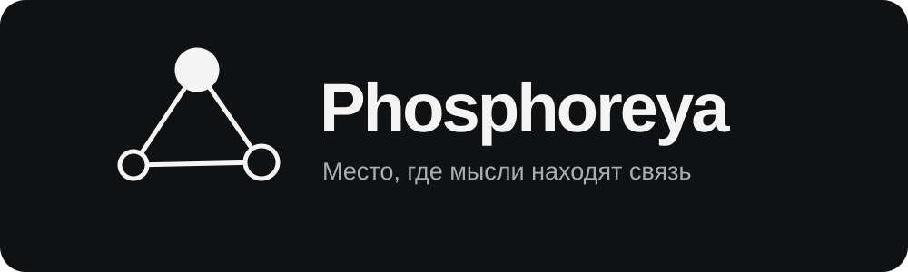
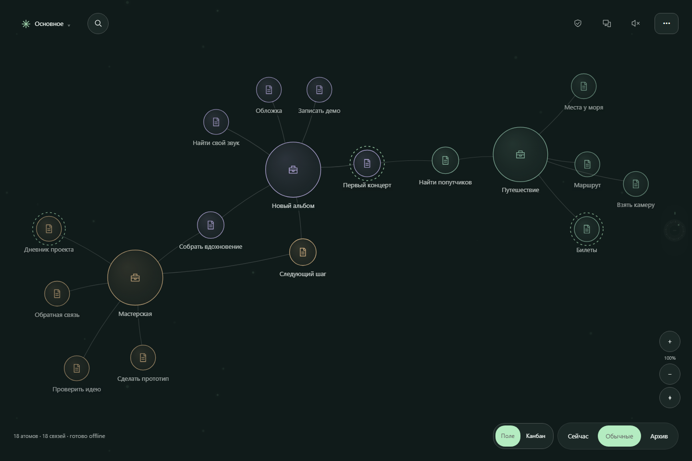
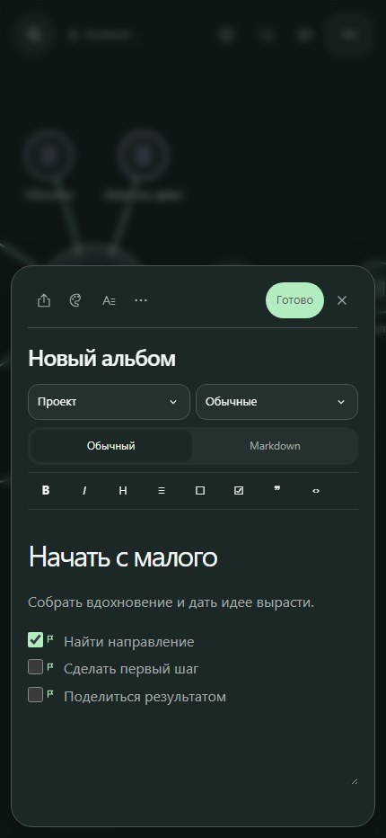

Личная карта заметок, людей, проектов и задач. На телефоне и компьютере. Бесплатно, без регистрации.

<a href="https://svyatoslavpodolskii.github.io/Phosphorea/"><strong>Открыть Phosphorea →</strong></a> &nbsp; · &nbsp; <a href="docs/README.md">Как пользоваться</a>

## Дайте идее место

Создайте заметку долгим нажатием на свободное место. Свяжите её с другой,
соберите мысли в папку или оставьте рядом — порядок можно найти по ходу.

- **Пишите:** заметки, списки и задачи с Markdown и обычным редактором.
- **Находите связи:** перемещайте атомы, выделяйте несколько лассо, ищите по тексту.
- **Действуйте:** держите важное в «Сейчас», разбирайте задачи на канбане.
- **Настраивайте под себя:** темы, типы заметок, физика карты и отключаемые плагины.
- **Продолжайте на другом устройстве:** QR-сопряжение с проверкой по эмодзи,
  обмен без облачного хранилища и сохранение разных версий при конфликте.

Записи хранятся в вашем браузере. После первой загрузки можно работать без
интернета; для связи устройств нужен интернет. Делайте резервные копии.

**[Начать за минуту, установить как приложение или узнать больше →](docs/README.md)**

Сделал [Святослав Подольский](https://t.me/Svyatoslav_Podolskii).
Туда же можно написать об ошибке или предложить идею.
[Поддержать разработку](https://www.donationalerts.com/r/svyatoslav_podolskiy).
