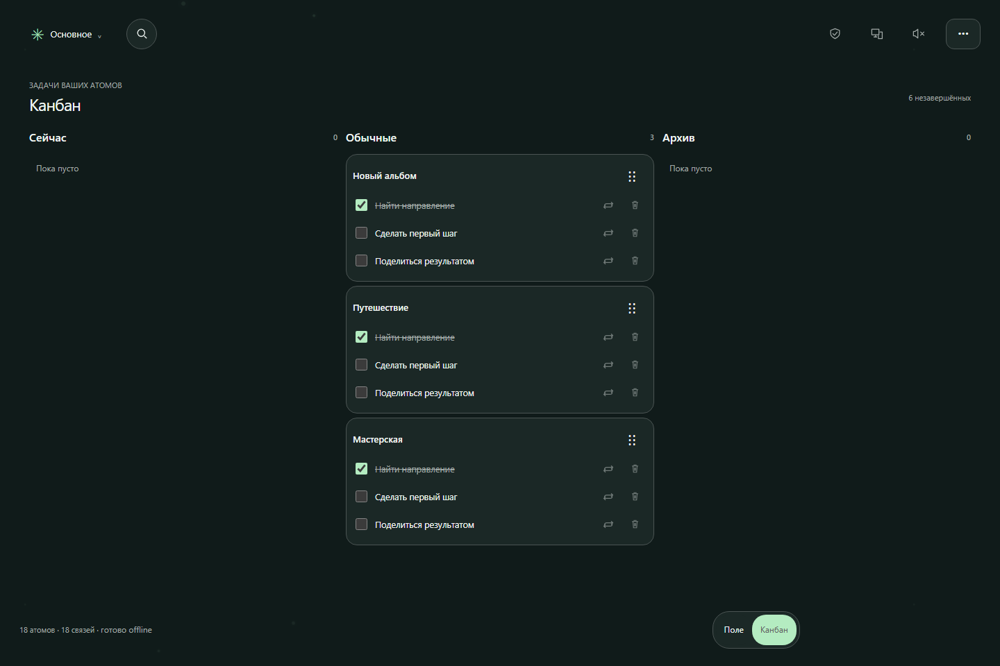

# Phosphoreya: с чего начать

[Открыть приложение →](https://svyatoslavpodolskii.github.io/Phosphoreya/)

Вы можете сразу пользоваться картой в браузере. Аккаунт, установка и скачивание
исходников не нужны.

| Хочу… | Куда перейти |
| --- | --- |
| Создать первую заметку, освоить жесты | [Начать за минуту](START_HERE.md) |
| Добавить значок на телефон или компьютер | [Установить как приложение](START_HERE.md#установить-как-приложение) |
| Добавить фото, видео, голос | [Медиа и Whisper](MEDIA.md) |
| Сохранить или перенести записи | [Данные и резервные копии](START_HERE.md#сохранить-записи) |
| Соединить телефон и компьютер | [Синхронизация через QR](SYNC.md) |
| Узнать, что изменилось | [Новое в версии 0.10.0](RELEASE_0100.md) |
| Сообщить об ошибке или предложить идею | [Написать автору в Telegram](https://t.me/Svyatoslav_Podolskii) |

## Возможности вживую

На главной карте мысли соединяются линиями. Задачи из заметок собираются
в канбан: обычный чекбокс остаётся в тексте, а чекбокс-задача появляется на доске.

## Если хочется разобраться глубже

- [Как устроены хранение данных, карта и плагины](ARCHITECTURE.md).
- [Создание своих плагинов](PLUGIN_API.md).
- [Локальный запуск, сборка и публикация на GitHub Pages](DEVELOPMENT.md).
- [Текущее состояние проекта](PROJECT_STATE.md).

Синхронизация защищает передачу и проверяет пару устройств. Локальная база пока
не зашифрована; это не обещание защиты от вредоносного обновления или доступа к
разблокированному устройству. Подробности — [в описании синхронизации](SYNC.md).
